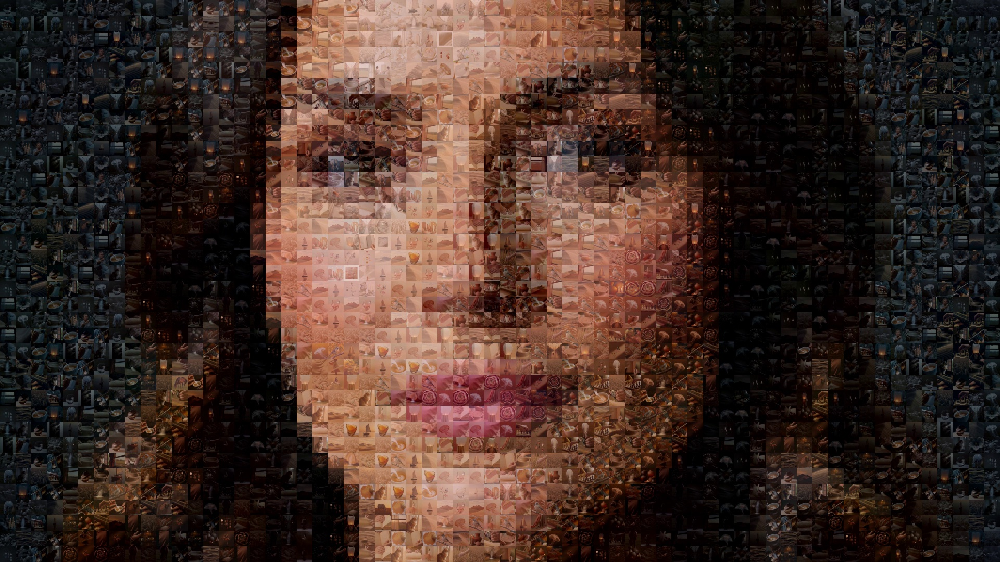
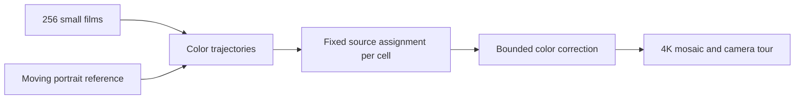

# H3 Max Videomosaic

**A moving portrait made of moving movies.**

GPT-6 Astra built the generation, matching, and compositing pipeline. H3 Max Turbo on [fal](https://fal.ai/models/minimax/h3-max-turbo/text-to-video) generated the footage: 256 original five-second movies at 480p, arranged into 2,304 continuously moving cells.

[](https://v3b.fal.media/files/b/0aa9bb13/XvYYx8AqcXZ_SKhSb0JIk_portrait-mosaic-showcase-1080p.mp4)

[Watch the 32-second showcase](https://v3b.fal.media/files/b/0aa9bb13/XvYYx8AqcXZ_SKhSb0JIk_portrait-mosaic-showcase-1080p.mp4) · [4K master](https://v3b.fal.media/files/b/0aa9bb1b/JIlfAF-2gJFJPxMO-VQjV_portrait-mosaic-showcase-4k.mp4)

Up close, every cell is a small film. From a distance, their changing colors form a face that turns, blinks, and smiles. The compositor adjusts tile colors; it does not overlay portrait pixels. The longer showcase repeats the five-second source movies with blended joins.

## Install

Use **Python 3.12+** and **FFmpeg** with the `libx264` encoder on your PATH. Set `FFMPEG_PATH` to an executable path if needed. No GPU is required locally; generation runs on fal.

```sh
git clone https://github.com/gokayfem/H3-Max-Videomosaic.git
cd H3-Max-Videomosaic
python -m venv .venv
# macOS / Linux
source .venv/bin/activate
# Windows PowerShell: .venv\Scripts\Activate.ps1
python -m pip install --upgrade pip
python -m pip install -c constraints.txt -e ".[upload]"
videomosaic --help
```

## Generate and render

Each run lives in its own ignored workspace. Preparation, analysis, matching, and rendering are local operations. Generation is a dry run unless you pass **`--execute`**. Review the generated job plans before running paid requests; current pricing is on the [model page](https://fal.ai/models/minimax/h3-max-turbo/text-to-video).

```sh
videomosaic init --workspace runs/portrait
videomosaic generate --workspace runs/portrait --group tiles

# Copy .env.example to .env and set FAL_KEY, or export FAL_KEY in your shell.
videomosaic generate --workspace runs/portrait --group portrait --env-file .env --execute
videomosaic generate --workspace runs/portrait --group tiles --env-file .env --execute

videomosaic analyze --workspace runs/portrait
videomosaic match --workspace runs/portrait
videomosaic render --workspace runs/portrait --style showcase --width 1920
videomosaic verify --workspace runs/portrait --file renders/showcase-1920.mp4
```

Render `--style wide` for the five-second full view, `--style reveal` for a short reveal, or `--style showcase` for the 32-second tour. Use `--width 3840` for a 4K export. Existing outputs require an explicit `--overwrite` to replace them.

To publish a chosen output to fal CDN:

```sh
videomosaic upload --workspace runs/portrait --file renders/showcase-1920.mp4
videomosaic upload --workspace runs/portrait --file renders/showcase-1920.mp4 --env-file .env --execute
```

The upload command also defaults to a dry run. With `--execute`, the selected video becomes accessible through the returned CDN URL. The key stays in the local environment or `.env`; it is never embedded in a video or public manifest.

## Use existing footage

You can run the entire local compositor without a fal key. Supply a portrait reference and a folder of square **480×480** source MP4s, each at least five seconds long:

```sh
videomosaic import --workspace runs/local --reference path/to/portrait.mp4 --clips path/to/clips
videomosaic analyze --workspace runs/local
videomosaic match --workspace runs/local
videomosaic render --workspace runs/local --style showcase --width 1920
```

## First / last-frame refinement

After matching, optionally prepare guided variants for cells whose lighting could be closer to the portrait:

```sh
videomosaic guide --workspace runs/portrait
videomosaic generate --workspace runs/portrait --group guided
videomosaic generate --workspace runs/portrait --group guided --env-file .env --execute
videomosaic select-guided --workspace runs/portrait
videomosaic render --workspace runs/portrait --style showcase --width 3840
```

The selector retains a variant only where measured color error improves and motion remains present. It keeps at least one placement of each original movie. The recorded experiment tested 16 variants and retained nine across 49 placements, for 265 distinct source files in the final mosaic. A new model run may produce different results.

## How it works



- **Temporal matching:** compare source and target colors at several times, with reuse penalties and neighborhood diversity.
- **Stable identity:** keep the same movie in each cell for the whole source sequence.
- **Detail at different scales:** recover original 480p frames for close views and use smaller decoded levels at a distance.
- **Controlled output:** explicit frame rate, Rec.709 SDR, deterministic camera poses, complete decoding verification, and atomic output replacement.

The grid is a finite approximation of the portrait. Color adjustment is central to the effect; this is not an unmodified tile-selection-only mosaic. The source library is reused across the 2,304 placements.

## Recorded experiment

| Measurement | Observed result |
| --- | --- |
| Original source batch | 256 × 5-second 480p clips |
| Generation plus downloads | 152.252 seconds |
| Median backend inference | 0.391 seconds per clip |
| Mosaic grid | 64 × 36 |
| Showcase export | 32 seconds, 3840×2160, 24 fps |

The inference figure is the endpoint's reported GPU denoising time, not end-to-end latency. These are measurements of one run, not throughput or cost guarantees. The published videos and stills are examples; generated clips, caches, API receipts, and credentials are not shipped in Git.

## Development

```sh
python -m pip install -c constraints.txt -e ".[dev,upload]"
ruff check .
ruff format --check .
pytest
python -m build
```

Tests use local synthetic videos and fake HTTP transports; they do not submit paid generations. See [operations and recovery](docs/operations.md), [architecture](docs/architecture.md), and [security](SECURITY.md).
