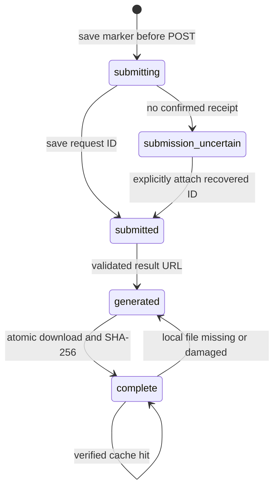

# Architecture

Importing the package performs no filesystem writes or network requests.

| Module | Responsibility |
| --- | --- |
| `cli` | Commands, explicit execution flags, errors, workspace lock |
| `storage` | Validated paths, atomic state, credentials, configuration |
| `plan` and `catalog.json` | Reproducible scene library and endpoint validation |
| `generation` | One-attempt submission, resumable polling, bounded downloads |
| `pipeline` | Import, color analysis, cache and assignment fingerprints |
| `matching` | Temporal assignment and per-cell color correction |
| `guidance` | First/last anchors and measured variant selection |
| `render` | Cameras, proxy levels, native frame streaming |
| `media` | Decode, atomic encode, output verification |
| `upload` | Explicit publication of one MP4 |

## Data flow

For `F` frames, `S` movies, `R` rows and `C` columns, analysis stores source mean
RGB as `F × S × 3`, portrait cell RGB as `F × R × C × 3`, and fixed source indices
as `R × C`. Each source also has a `F × 64 × 64 × 3` uint8 proxy.

The portrait is resized to four samples per cell axis, averaged within each cell,
and smoothed slightly in time. Up to 16 samples in CIELAB describe each source
and target trajectory. Matching favors lower trajectory error while penalizing
excessive reuse and neighboring duplicates. A coverage pass gives every source
at least one cell.

The assigned movie supplies all spatial texture in its cell. Correction shifts
its mean toward the portrait cell and scales contrast within a bounded gamut.
Detail increases during close camera views. Portrait pixels are never overlaid.

Native frame selection uses `floor(output_frame × native_fps / output_fps)`.
Camera zoom interpolates in log space and position uses quintic easing. Source
movies and target colors use the same loop indices and blend weights.

## Guided variants

Candidates cover steady, brightening, darkening, and passing-shadow trajectories.
First and last anchors are color-adjusted frames of the selected movie, passed
to the H3 Max Turbo image-to-video endpoint.

A variant replaces only placements whose **mean squared RGB trajectory error
improves by more than 7%**, while retaining measurable motion relative to the
source. At least one placement of every original remains. This color-and-motion
test is not a learned perceptual metric or a guarantee of correct visual details.

## Queue states

Authenticated URLs are derived from a validated request ID and pinned to
`queue.fal.run`. Response URLs cannot redirect the key to another host. Media
downloads are unauthenticated HTTPS requests restricted to fal media hosts.
The official SDK handles separately authorized storage uploads.

## Reproducibility

Configuration, inputs, source hashes, seeds, assignments, and camera poses make
local decisions repeatable. Model outputs may change with service updates, and
encoder versions can change MP4 bytes. The public showcase documents the original
experiment; the CLI creates a new run or processes existing footage without a key.

Endpoint schemas checked September 9, 2026:
[text-to-video](https://fal.ai/models/minimax/h3-max-turbo/text-to-video/llms.txt)
and [image-to-video](https://fal.ai/models/minimax/h3-max-turbo/image-to-video/llms.txt).
Backend inference timings describe GPU denoising, not total request latency.
